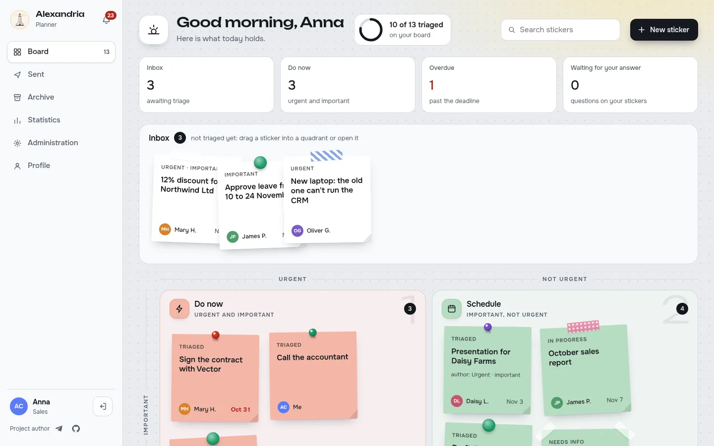
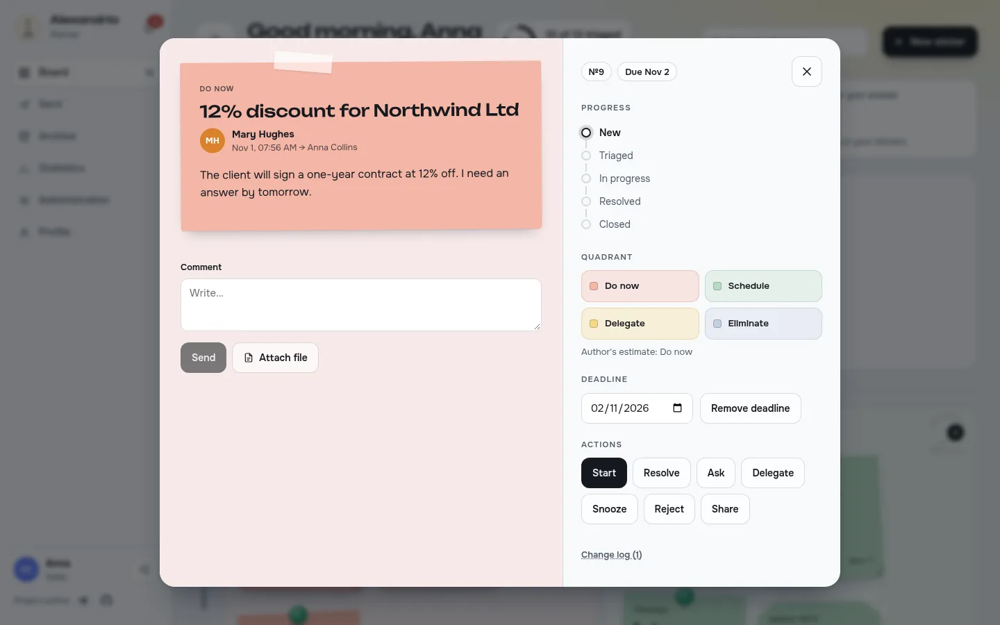
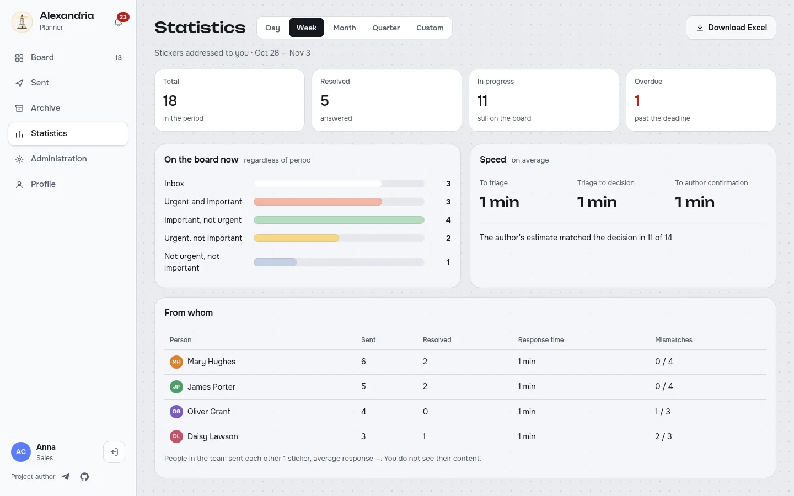
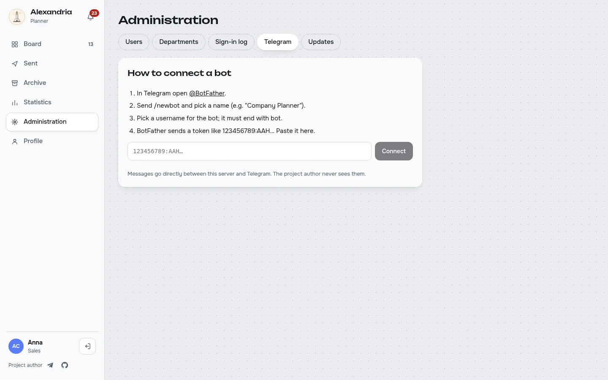
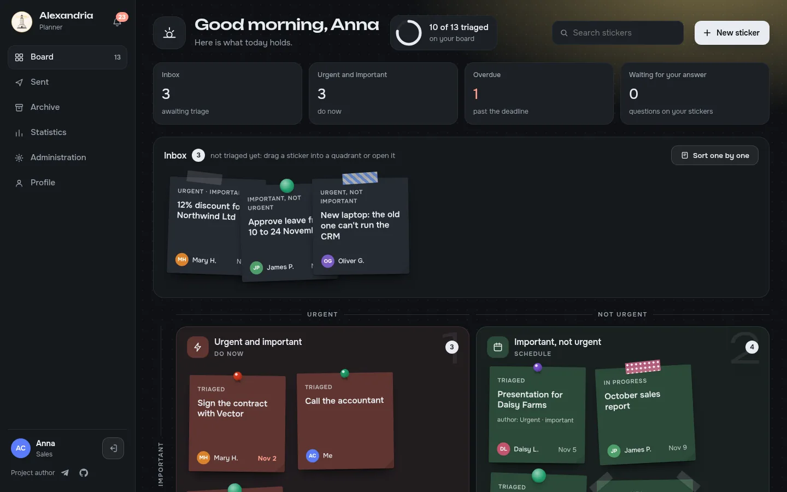

<p align="center">
  
</p>

<h1 align="center">Alexandria Planner</h1>

<p align="center">
  Sticky notes from employees to managers, sorted by the Eisenhower matrix.<br>
  Self-hosted, open source, with your own Telegram bot.
</p>

<p align="center">
  <b>English</b> · <a href="README.ru.md">Русский</a> ·
  <a href="https://github.com/Loktionov-g-bit/alexandria-planner/actions"></a>
</p>



## What it is

Most "to-do" tools assign work top-down. Alexandria Planner is the other direction: an employee writes a
short sticker to their manager (a question, a request, an idea, a problem), and the manager sorts it on
a board of four quadrants:

| | Urgent | Not urgent |
|---|---|---|
| **Important** | Urgent and important: do now | Important, not urgent: schedule |
| **Not important** | Urgent, not important: delegate | Not urgent, not important: eliminate |

Every sticker then has a clear life: asked for details, delegated, snoozed, resolved with an answer, and
confirmed by the author. Nothing gets lost in chats and nobody has to ask "did you see my message?".

## Features

- **Paper-like board** with drag and drop, inbox, and an opened-sticker view with history, comments and files.
- **Full sticker lifecycle**: ask, delegate, snooze, resolve (approved / declined / done / FYI), reject, reopen.
- **Deadlines that escalate**: an overdue sticker becomes more urgent on its own.
- **Telegram bot, your own**: notifications with buttons, a main menu, writing stickers to a manager,
  team or colleague, Done / Not done right from the chat, `/stiker` in a group chat.
- **Backup route to Telegram through WireGuard** for servers where Telegram is blocked: upload a `.conf`
  in the admin panel; only Telegram traffic uses it.
- **Statistics** with Excel export: per quadrant, per person, response times, author vs manager estimates.
- **Security**: mandatory 2FA (TOTP) for managers and admins, password rules, login throttling,
  sign-in log, httpOnly sessions.
- **Seven languages**: English, Russian, German, Czech, Belarusian, Kazakh, Georgian.
- **Updates without downtime**: stable and beta channels on one database, per user or team.
- **Team or diary**: on first launch choose a personal diary for one person; it can grow into a team later.
- **Sort one by one, calendar, time off**: sort the inbox with keys 1–4, see deadlines in your phone calendar (ICS), a deputy gets new stickers while you are away.
- **Light**: one app container plus PostgreSQL, the whole stack idles under 512 MB RAM. amd64 and arm64.
- **Phone-ready**: responsive PWA, browser push notifications.

<table>
  <tr>
    <td></td>
    <td></td>
  </tr>
  <tr>
    <td></td>
    <td></td>
  </tr>
</table>

## Install

You need Docker with Compose v2.

```sh
mkdir alexandria-planner && cd alexandria-planner
curl -fsSLO https://raw.githubusercontent.com/Loktionov-g-bit/alexandria-planner/main/docker-compose.yml
curl -fsSL https://raw.githubusercontent.com/Loktionov-g-bit/alexandria-planner/main/.env.example -o .env
# edit .env: POSTGRES_PASSWORD (openssl rand -hex 24) and PLANNER_BASE_URL
docker compose up -d
```

Open `http://<server>:8000` (or your `PLANNER_BASE_URL`). The first-run wizard asks for the mode (team or diary), creates the team and the
administrator and asks to set up 2FA. There are no default passwords.

**Synology NAS**: use [`deploy/synology/compose.yaml`](deploy/synology/compose.yaml) as a Container Manager
project; the comments at the top of the file list the steps.

**HTTPS**: put the app behind your reverse proxy (Synology DSM, nginx, Traefik, Caddy) and set
`PLANNER_BASE_URL=https://…`. Session cookies become `Secure` automatically; `X-Forwarded-*` headers are honoured.

### Settings

All settings are environment variables with the `PLANNER_` prefix:

| Variable | Default | Meaning |
|---|---|---|
| `PLANNER_BASE_URL` | `http://localhost:8000` | Public address, used in links and for secure cookies |
| `PLANNER_DATABASE_URL` | set by compose | PostgreSQL connection |
| `PLANNER_FORWARDED_ALLOW_IPS` | private networks | Proxies whose `X-Forwarded-*` are trusted; set your proxy's address |
| `PLANNER_IP_MAX_FAILURES` | `20` | Failed sign-ins from one IP per 15 min before it is paused |
| `PLANNER_API_DOCS` | `false` | Expose `/api/docs` (API schema) |
| `PLANNER_SESSION_DAYS` | `14` | Session lifetime |
| `PLANNER_LOGIN_MAX_ATTEMPTS` | `5` | Failed logins before a temporary lock |
| `PLANNER_PASSWORD_MIN_LENGTH` | `10` | Minimum password length |
| `PLANNER_BACKUP_KEEP` | `10` | Database backups kept before migrations |

### Telegram

Create a bot with [@BotFather](https://t.me/BotFather) and paste its token in **Administration → Telegram**.
Messages go straight between your server and Telegram; nothing passes through the author of the project.
Employees link their accounts in their profile.

If your server cannot reach Telegram, upload a WireGuard config (`.conf` or `.zip`) in the same section.
It runs inside the container in user space (no extra privileges) and is used only for Telegram:
as a fallback when the direct route fails, or always. AmneziaWG configs are not supported.

### Updates

```sh
docker compose pull && docker compose up -d
```

The database is backed up automatically before every migration (`/data/backups`).
To try a new version on a few people first, see [docs/updates.md](docs/updates.md) (stable / beta channels).

## User guide

A step-by-step illustrated guide for employees, managers and administrators is built into the app
(**Profile → User guide**) and lives in [`frontend/public/guide`](frontend/public/guide) in all seven languages.

## Development

```sh
# backend: Python 3.12, uv
cd backend && uv sync && uv run pytest
# PLANNER_TEST_DATABASE_URL=postgresql+asyncpg://… runs the tests on PostgreSQL
# frontend: Node 20+, npm 10+
cd frontend && npm ci && npm run dev
```

Stack: FastAPI, SQLAlchemy 2 + Alembic, PostgreSQL 16; React + Vite + TypeScript, dnd-kit, TanStack Query.
The product specification (in Russian) is in [docs/SPEC.md](docs/SPEC.md).
The guide screenshots are generated from a running instance with fictional people: [docs/guide-tools](docs/guide-tools).

## Security

Please report vulnerabilities privately, see [SECURITY.md](SECURITY.md).

Before you open the app to the internet:

- **Finish the first-run wizard first.** Until it is done, whoever opens the page first becomes the administrator.
- **Serve it over HTTPS only**, through a reverse proxy; do not publish port 8000 to the internet directly.
- Keep `.env` private and use a long random `POSTGRES_PASSWORD`. The database port is not published by default; keep it so.
- Update regularly: `docker compose pull && docker compose up -d`.

## Author

Made by [Loktionov-g-bit](https://github.com/Loktionov-g-bit) · Telegram [@marshall033](https://t.me/marshall033)

Released under the [MIT License](LICENSE).
