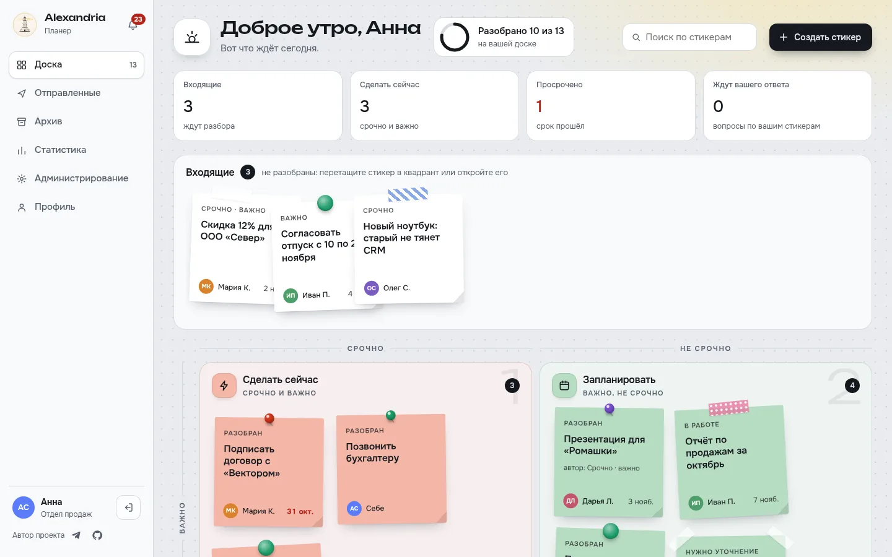
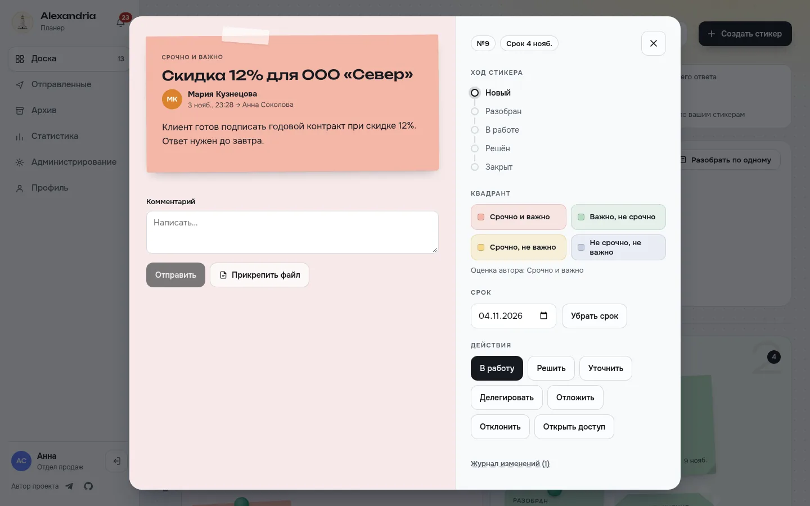
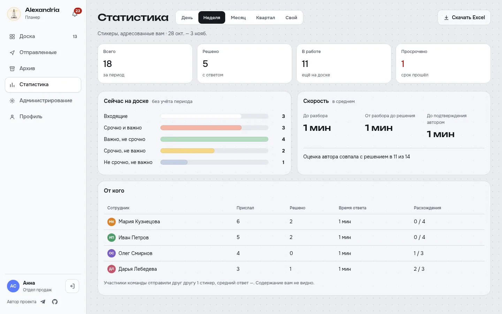
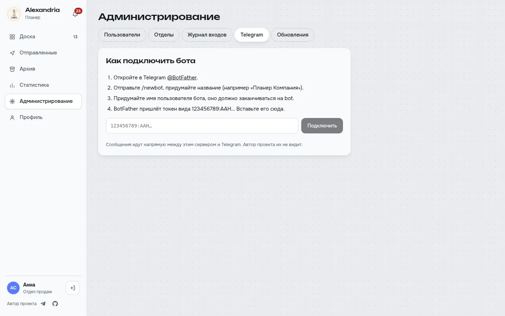
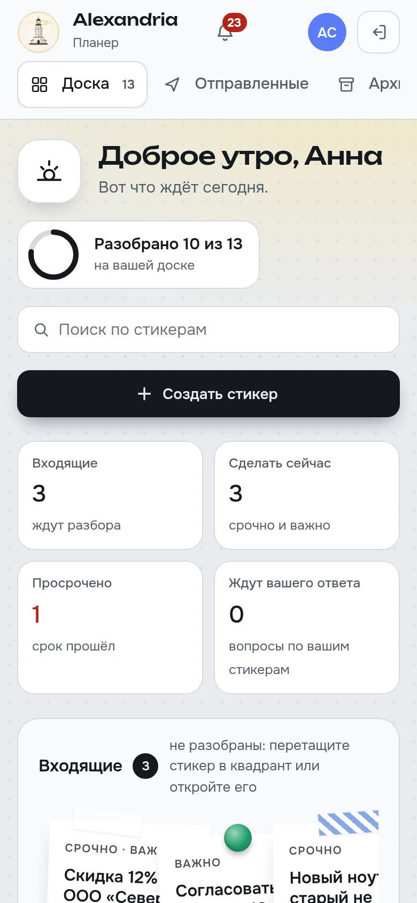

<p align="center">
  
</p>

<h1 align="center">Alexandria Планер</h1>

<p align="center">
  Стикеры от сотрудников руководителю, разложенные по матрице Эйзенхауэра.<br>
  На своём сервере, с открытым кодом и вашим собственным Telegram-ботом.
</p>

<p align="center">
  <a href="README.md">English</a> · <b>Русский</b>
</p>



## Что это

Обычные таск-трекеры раздают задачи сверху вниз. Планер работает в обратную сторону: сотрудник пишет
руководителю короткий стикер (вопрос, просьбу, идею, проблему), а руководитель раскладывает его по доске
из четырёх квадрантов:

| | Срочно | Не срочно |
|---|---|---|
| **Важно** | Срочно и важно: сделать сейчас | Важно, не срочно: запланировать |
| **Не важно** | Срочно, не важно: поручить | Не срочно, не важно: не делать |

Дальше у каждого стикера понятная судьба: уточнили, поручили, отложили, решили с ответом, автор подтвердил.
Ничего не теряется в чатах, и никому не приходится спрашивать «ты видел моё сообщение?».

## Возможности

- **Доска как из бумаги**: перетаскивание, «Входящие», открытый стикер с историей, комментариями и файлами.
- **Полный жизненный цикл**: уточнить, поручить, отложить, решить (согласовано / отклонено / выполнено /
  к сведению), отклонить, переоткрыть.
- **Сроки поднимают срочность**: просроченный стикер сам становится срочнее.
- **Свой Telegram-бот**: уведомления с кнопками, главное меню, стикер руководителю, в другую команду или
  коллеге, «Выполнено» и «Не выполнено» прямо из чата, `/stiker` в рабочей группе.
- **Резервная связь с Telegram через WireGuard** для серверов, где Telegram заблокирован: загрузите `.conf`
  в админке, через туннель пойдёт только трафик Telegram.
- **Статистика** с выгрузкой в Excel: по квадрантам, по людям, время ответа, расхождение оценок.
- **Безопасность**: обязательная 2FA (TOTP) для руководителей и администраторов, требования к паролям,
  ограничение попыток входа, журнал входов, сессии в httpOnly-cookie.
- **Семь языков**: русский, английский, немецкий, чешский, белорусский, казахский, грузинский.
- **Обновления без простоя**: каналы stable и beta на одной базе, по пользователю или команде.
- **Команда или ежедневник**: при первом запуске можно выбрать личный ежедневник для одного человека; позже его можно превратить в команду.
- **Разбор по одному, календарь и отпуск**: входящие разбираются клавишами 1–4, сроки видны в календаре телефона (ICS), на время отпуска стикеры получает заместитель.
- **Лёгкий**: один контейнер приложения и PostgreSQL, весь стек в простое меньше 512 МБ памяти. amd64 и arm64.
- **С телефона**: адаптивное PWA, уведомления в браузере.

<table>
  <tr>
    <td></td>
    <td></td>
  </tr>
  <tr>
    <td></td>
    <td></td>
  </tr>
</table>

## Установка

Нужен Docker с Compose v2.

```sh
mkdir alexandria-planner && cd alexandria-planner
curl -fsSLO https://raw.githubusercontent.com/Loktionov-g-bit/alexandria-planner/main/docker-compose.yml
curl -fsSL https://raw.githubusercontent.com/Loktionov-g-bit/alexandria-planner/main/.env.example -o .env
# в .env задайте POSTGRES_PASSWORD (openssl rand -hex 24) и PLANNER_BASE_URL
docker compose up -d
```

Откройте `http://<сервер>:8000` (или ваш `PLANNER_BASE_URL`). Мастер первого запуска спросит режим (команда или ежедневник), создаст команду и
администратора и попросит включить 2FA. Паролей по умолчанию нет.

**Synology NAS**: используйте [`deploy/synology/compose.yaml`](deploy/synology/compose.yaml) как проект
Container Manager, шаги описаны в начале файла.

**HTTPS**: поставьте приложение за обратный прокси (Synology DSM, nginx, Traefik, Caddy) и укажите
`PLANNER_BASE_URL=https://…`. Cookie сессии сами станут `Secure`, заголовки `X-Forwarded-*` учитываются.

Все настройки и их значения по умолчанию перечислены в [английском README](README.md#settings).

### Telegram

Создайте бота у [@BotFather](https://t.me/BotFather) и вставьте токен в **Администрирование → Telegram**.
Сообщения идут напрямую между вашим сервером и Telegram, через автора проекта ничего не проходит.
Сотрудники привязывают свой Telegram в профиле.

Если сервер не достаёт до Telegram, загрузите в том же разделе конфигурацию WireGuard (`.conf` или `.zip`).
Она работает внутри контейнера без дополнительных прав и используется только для Telegram: как запасной
путь, когда напрямую не получается, или всегда. Конфигурации AmneziaWG не поддерживаются.

### Обновление

```sh
docker compose pull && docker compose up -d
```

Перед каждой миграцией база сохраняется автоматически (`/data/backups`).
Как сначала дать новую версию нескольким людям: [docs/updates.md](docs/updates.md) (каналы stable и beta).

## Руководство пользователя

Пошаговое руководство со скриншотами для сотрудника, руководителя и администратора встроено в программу
(**Профиль → Руководство пользователя**) и лежит в [`frontend/public/guide`](frontend/public/guide) на всех семи языках.

## Разработка

```sh
# бэкенд: Python 3.12, uv
cd backend && uv sync && uv run pytest
# PLANNER_TEST_DATABASE_URL=postgresql+asyncpg://… запускает тесты на PostgreSQL
# фронтенд: Node 20+, npm 10+
cd frontend && npm ci && npm run dev
```

Спецификация продукта: [docs/SPEC.md](docs/SPEC.md).

## Безопасность

Об уязвимостях сообщайте закрыто, см. [SECURITY.md](SECURITY.md).

Перед тем как открыть Планер в интернет:

- **Сначала пройдите мастер первого запуска.** Пока он не пройден, администратором станет тот, кто первым откроет страницу.
- **Только через HTTPS**, за обратным прокси; не открывайте порт 8000 в интернет напрямую.
- Храните `.env` в тайне и задайте длинный случайный `POSTGRES_PASSWORD`. Порт базы по умолчанию наружу не открыт, так и оставьте.
- Регулярно обновляйтесь: `docker compose pull && docker compose up -d`.

## Автор

[Loktionov-g-bit](https://github.com/Loktionov-g-bit) · Telegram [@marshall033](https://t.me/marshall033)

Лицензия [MIT](LICENSE).
